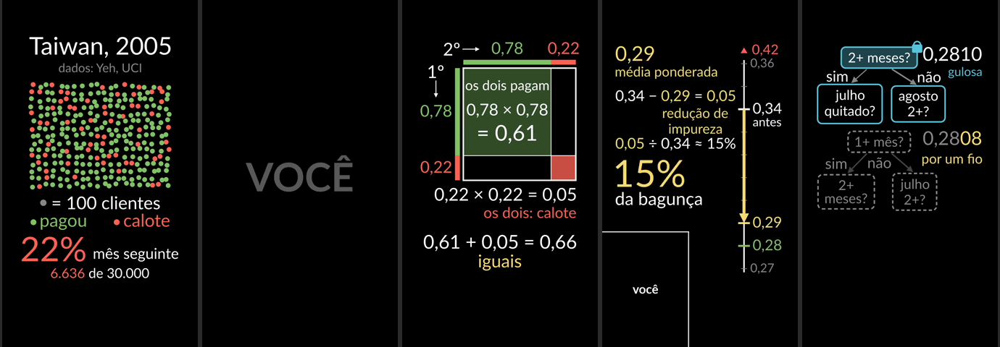
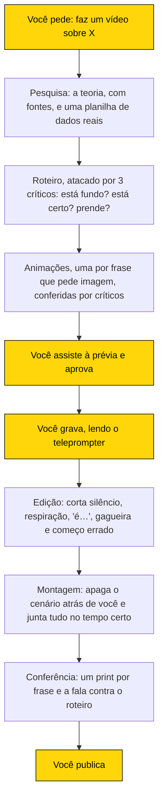
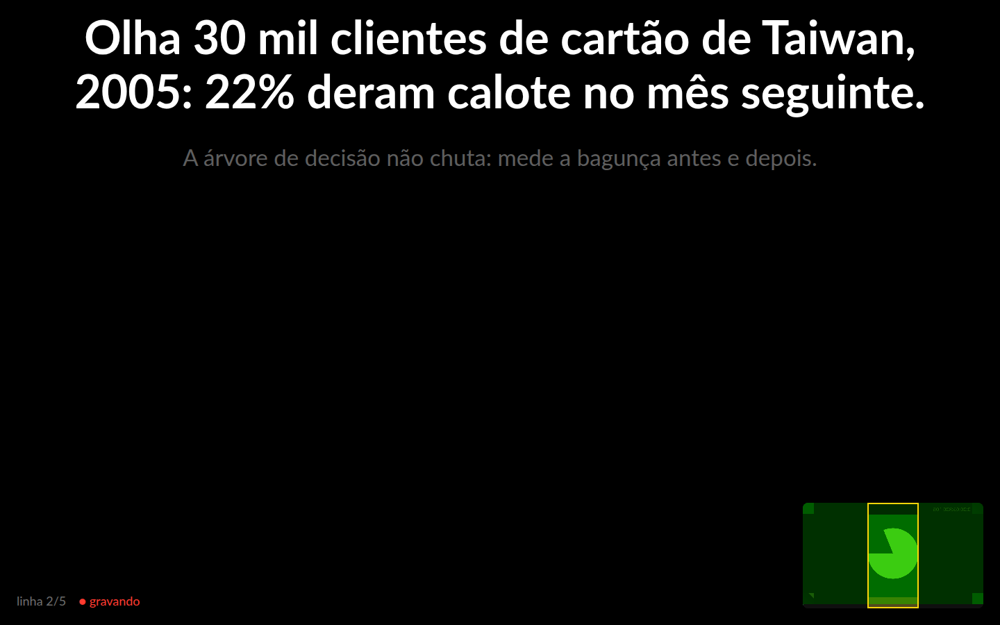

# humanim

**humanim faz vídeos curtos que explicam inteligência artificial, com a sua cara, a sua voz e animações feitas por IA.** O nome junta *humano* + *Manim*, um programa gratuito de animação de matemática (o do canal 3Blue1Brown no YouTube): fundo preto, formas e números que se mexem.

É para quem quer explicar IA no LinkedIn sem saber animar, editar ou programar. Você entra com a cara, a voz e a aprovação. O resto é com a IA.



*Momentos das animações do primeiro vídeo, tirados da prévia. "VOCÊ" e "você" marcam onde a pessoa aparece: em tela cheia ou no canto, junto da animação.*

## A ideia em uma frase

Você diz ao Claude "faz um vídeo sobre X". Ele pesquisa, escreve o roteiro, cria as animações e te mostra uma prévia. Você aprova e grava lendo um teleprompter. Ele edita e monta o vídeo, pronto para postar.

**Claude** é a IA da Anthropic. Você conversa com ele por escrito, e ele faz o trabalho no computador. Neste projeto, ele trabalha como uma pequena equipe: pesquisadores, roteirista, críticos, animadores e editor são o próprio Claude em papéis diferentes, vários ao mesmo tempo.

## Como um vídeo nasce



Os quadros amarelos são os únicos momentos em que você entra. No resto, a IA decide sozinha o foco do vídeo, os dados, a ordem das ideias e os cortes.

## As regras de todo vídeo

- **Uma teoria pesada, desmontada em passos que dá para acompanhar.** O vídeo mostra como a coisa funciona por dentro, não só o nome. Quem assiste sai sabendo refazer a conta.
- **Dados reais.** O exemplo vem de um dataset, uma planilha de dados reais e públicos, com fonte. Cada número é calculado por um programa a partir desses dados, nunca digitado à mão.
- **Uma frase puxa a outra.** Se dá para tirar uma frase sem quebrar a lógica, ela sai.
- **Um conceito só, em 60 a 90 segundos.** Melhor uma ideia inteira com calma do que três pela metade.

## O roteiro

Cada linha do roteiro é uma frase que você fala. Uma marca no começo diz o que aparece na tela enquanto você fala:

| Marca | O que aparece na tela |
| --- | --- |
| `[CARA]` | Você, em tela cheia. |
| `[ANIM]` | Só a animação, com a sua voz por baixo. |
| `[CANTO]` | A animação, com você no canto de baixo à esquerda, sempre encostado na borda. |

Três linhas do vídeo de árvore de decisão:

| Marca | O que aparece | O que você fala |
| --- | --- | --- |
| `[ANIM]` | 300 pontos, cada um vale 100 clientes; 22% ficam vermelhos | "Olha 30 mil clientes de cartão de Taiwan, 2005: 22% deram calote no mês seguinte." |
| `[CARA]` | você | "A árvore de decisão não chuta: mede a bagunça antes e depois." |
| `[CANTO]` | dois clientes sorteados, que depois mostram a cor | "Bagunça é isto: sorteia dois clientes. Qual a chance de serem diferentes?" |

Por isso a montagem é automática: o roteiro já diz quando entra você, quando entra a animação e quando entram os dois.

## Gravando

O teleprompter abre numa janela do Chrome. A frase que você está falando fica grande, colada embaixo da webcam, e a próxima aparece menor, logo abaixo.



| Tecla | Faz |
| --- | --- |
| Espaço | Começa (contagem 3, 2, 1) e passa para a próxima frase |
| R | Regrava a frase atual (vale a última vez) |
| Esc | Para e salva |

- **A imagem da sua câmera** fica pequena no canto de baixo, à direita. A **barra verde** logo embaixo dela é o microfone: se ela não mexe quando você fala, o microfone está no mudo.
- **O retângulo amarelo** é o pedaço da câmera que entra no vídeo. Fique dentro dele, com a cabeça abaixo da faixa escura de cima, onde o LinkedIn põe o seu nome e os botões.
- **Errou? Respire e repita a frase inteira.** A edição fica com a última tentativa e corta o resto.
- **Não precisa correr.** As pausas saem na edição.

## Quanto tempo leva

Montar a ferramenta deu trabalho uma vez só. Para cada vídeo novo, as estimativas são:

| Parte | Tempo da máquina | O seu tempo |
| --- | --- | --- |
| Do pedido à prévia | meta de 1h30 (o primeiro vídeo levou umas 4 h; o processo foi ajustado para fazer mais coisas ao mesmo tempo) | assistir e aprovar |
| Gravação | — | uns 2 a 5 min |
| Da gravação ao vídeo pronto | uns 15 min para 2 min de gravação | nada |
| Publicação | — | postar |

São medições feitas com uma gravação de teste. A primeira gravação de verdade vai confirmar os números.

## Vídeos

| Vídeo | O que explica | Dados | Situação |
| --- | --- | --- | --- |
| [Árvore de decisão](videos/arvore-de-decisao/roteiro.md?plain=1) | Como a árvore escolhe a melhor pergunta para separar quem paga de quem dá calote | 30 mil clientes de cartão de crédito de Taiwan, 2005, da [base pública da Universidade da Califórnia em Irvine](https://archive.ics.uci.edu/dataset/350/default+of+credit+card+clients) | roteiro, animações e prévia prontos; falta gravar |
| [KNN, k vizinhos mais próximos](videos/knn/roteiro.md?plain=1) | Por que, sem padronizar as medidas, o peso em gramas decide sozinho quem é vizinho | 342 pinguins da Antártida (Palmer Station, Gorman, Williams & Fraser, 2014), via [palmerpenguins](https://allisonhorst.github.io/palmerpenguins/), domínio público | roteiro, animações e prévia prontos; falta gravar |

Cada pasta em `videos/` guarda o projeto do vídeo: o roteiro, a pesquisa escrita ([exemplo das fontes](videos/arvore-de-decisao/fontes.md)), os dados, o programa que calcula os números e o código das animações. A gravação e o vídeo final ficam só no computador, porque são pesados demais para o GitHub.

---

## Parte técnica

Se você só apresenta, pode parar aqui: quem instala é quem cuida do computador.

### Instalar

Precisa de:

- um computador com Ubuntu, webcam e microfone;
- Google Chrome, ffmpeg, [Homebrew](https://brew.sh) e [uv](https://docs.astral.sh/uv/) (se ainda não estiverem instalados, alguns pedem senha de administrador);
- o [Claude Code](https://claude.com/claude-code), com uma conta da Anthropic e internet.

Não precisa de placa de vídeo. Depois, na pasta do projeto:

```bash
./instalar.sh
```

Abra o Claude Code na pasta do projeto e peça "faz um vídeo sobre X". A transcrição da fala e a remoção do cenário rodam no seu computador, sem pagar nada a mais. Na primeira edição e na primeira remoção de cenário, a ferramenta baixa esses modelos de IA: uns 1,6 GB, ou 2,1 GB se também precisar do modelo menor. O Claude precisa de internet, e a pesquisa busca fontes na web.

<details>
<summary>Os comandos, para quem quiser rodar à mão</summary>

| Comando | O que faz |
| --- | --- |
| `humanim novo <nome>` | cria a pasta do vídeo |
| `humanim contar videos/<nome>/roteiro.md` | quanto cada frase vai durar |
| `humanim animar videos/<nome>/roteiro.md` | renderiza as animações |
| `humanim previa videos/<nome>` | abre a prévia no navegador |
| `humanim gravar videos/<nome>/roteiro.md` | abre o teleprompter e grava |
| `humanim editar videos/<nome>/gravacao.webm` | corta pausas, muletas e repetições |
| `humanim tratar videos/<nome>/gravacao.webm` | remove o cenário atrás de você |
| `humanim montar videos/<nome>` | junta tudo no `saida.mp4` |
| `humanim frames videos/<nome>/saida.mp4` | tira um print de cada frase para conferir |

Toda resposta dos comandos termina com `OK` ou `ERRO`, e todo erro diz o que fazer.

</details>

### Onde fica cada coisa

```
CLAUDE.md          como o Claude deve trabalhar neste projeto
.claude/skills/    os manuais do Claude: diretor (toca o vídeo inteiro), roteiro e cenas
estilo/            cores, fonte e fundo das animações
humanim/           o código do comando humanim
videos/            um projeto por vídeo
docs/              imagens deste README
```

### Limites conhecidos

- **Webcam comum (720p).** Em tela cheia, a imagem é recortada na vertical e ampliada, então fica um pouco menos nítida.
- **Olhar para a câmera.** Nenhum programa ajeita o olhar, mas a frase aparece logo embaixo da webcam, e o desvio não se nota.
- **Memória.** O computador usado tem 7 GB de memória (RAM), então as etapas pesadas rodam uma de cada vez.
- **Testado com voz sintética.** O fluxo inteiro foi testado com câmera, microfone e voz falsos. A primeira gravação de verdade ainda vai mostrar o que falta ajustar.

### Feito com

[Manim Community](https://www.manim.community) (animações), [ffmpeg](https://ffmpeg.org) (montagem), [faster-whisper](https://github.com/SYSTRAN/faster-whisper) com os modelos Whisper (transcrição), [Robust Video Matting](https://github.com/PeterL1n/RobustVideoMatting) (remoção do cenário) e [Claude Code](https://claude.com/claude-code).
